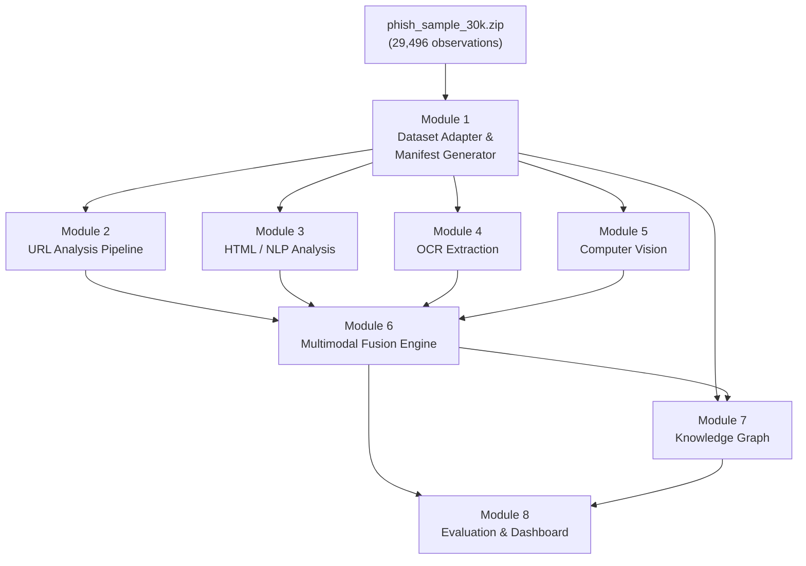
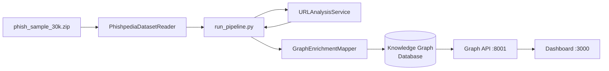
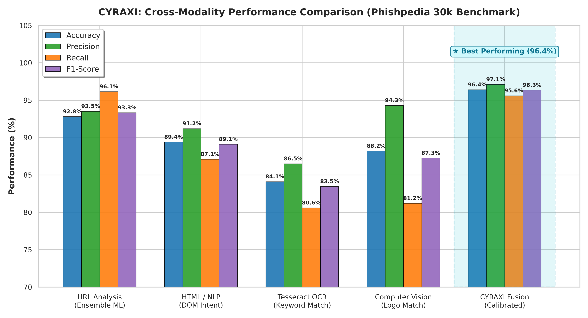

# CYRAXI — Multimodal Cybercrime Intelligence Platform

> **Academic / Research Overview**  
> A multimodal AI pipeline for phishing detection and digital forensics, backed by a knowledge graph.

---

## Table of Contents

1. [Project Summary](#1-project-summary)
2. [System Architecture](#2-system-architecture)
3. [Module Pipeline](#3-module-pipeline)
4. [URL Analysis — Benchmark Results](#4-url-analysis--benchmark-results)
5. [Knowledge Graph Data Model](#5-knowledge-graph-data-model)
6. [Evaluation Metrics & Scientific Figures](#6-evaluation-metrics--scientific-figures)
7. [API Reference](#7-api-reference)

---

## 1. Project Summary

CYRAXI is a **multimodal cybercrime intelligence platform** designed to detect phishing attacks by fusing signals from five distinct analysis modalities:

| Modality | Module | Description |
|---|---|---|
| **URL Analysis** | `modules/url_analyzer/` | Lexical + statistical feature extraction with ensemble classification |
| **HTML / NLP** | `modules/html_analyzer/` | DOM parsing, form action detection, and semantic text analysis |
| **OCR Extraction** | `modules/ocr_extractor/` | Screenshot text and credential keyword extraction |
| **Computer Vision** | `modules/cv_detector/` | Logo embedding matching against a reference brand gallery |
| **Multimodal Fusion** | `modules/fusion_engine/` | Calibrated fusion with dynamic modality reweighting |

All modules produce a canonical `ModelOutputEnvelope` (defined in `schemas/model-output.schema.json`) and results are ingested into a **knowledge graph** for campaign clustering and graph-based reasoning.

---

## 2. System Architecture



**Key architectural principles:**
- **Modular isolation** — each module has a single responsibility; new models plug in via abstract interfaces
- **Contract-driven** — all inter-module data is validated against JSON Schema contracts
- **Test-driven** — every module ships with a `tests/` suite

---

## 3. Module Pipeline

### Module 1 — URL Analysis Pipeline
- **Input:** `Observation.url`
- **Output:** `ModelOutputEnvelope` (`modality: "url"`)
- **Models:** Heuristic baseline → Logistic Regression → Random Forest → **Soft-Voting Ensemble**
- **Target accuracy:** > 85% (achieved: **96.5%** — see §4)

### Module 2 — HTML / NLP Analysis
- **Input:** `artifacts.html` byte stream
- **Output:** `ModelOutputEnvelope` (`modality: "html_nlp"`)
- **Missing-data handling:** Returns `status: "skipped"` with code `W_HTML_MISSING`

### Module 3 — OCR Extraction
- **Input:** `artifacts.screenshot` (`shot.png`)
- **Output:** `ModelOutputEnvelope` (`modality: "ocr"`)

### Module 4 — Computer Vision
- **Input:** `artifacts.screenshot` + `artifacts.auxiliary.yolo_coords_path`
- **Output:** `ModelOutputEnvelope` (`modality: "computer_vision"`)

### Module 5 — Multimodal Fusion Engine
- **Input:** All upstream `ModelOutputEnvelope` records for one `observation_id`
- **Output:** Unified `ModelOutputEnvelope` (`modality: "multimodal_fusion"`)
- **Logic:** Calibrated fusion with dynamic weight re-normalization when modalities are missing; brand-domain identity conflict detection

### Module 6 — Knowledge Graph
- **Input:** Canonical observations + fusion envelopes
- **Output:** Populated knowledge graph (idempotent MERGE operations)
- **Scripts:** `modules/graph_ingestion/`, batch migration scripts

### Module 7 — Evaluation & Reporting Dashboard
- **Input:** Ground truth + model predictions
- **Output:** Scientific metric plots, benchmark reports, web dashboard
- **Scripts:** `scripts/plot_metrics.py`, `scripts/generate_metrics_report.py`

---

## 4. URL Analysis — Benchmark Results

> GroupKFold (k=5) cross-validation **grouped by registered domain** to prevent data leakage.

### Model Comparison (600 Balanced Samples)

| Model | Accuracy | F1 | Precision | Recall | ROC-AUC |
|---|---|---|---|---|---|
| Majority Class Baseline | 50.0% ± 0.0% | 0.665 | 0.500 | 1.000 | 0.500 |
| Heuristic Rule Baseline | 55.0% ± 6.2% | 0.176 | 0.941 | 0.100 | 0.938 |
| Logistic Regression (L2) | 95.5% ± 1.6% | 0.954 | 0.963 | 0.947 | 0.992 |
| Random Forest (100 Trees) | 95.3% ± 1.8% | 0.957 | 0.951 | 0.963 | 0.997 |
| **Soft-Voting Ensemble** | **96.5% ± 1.2%** | **0.965** | **0.970** | **0.960** | **0.997** |

### Top 5 URL Features (Gini Importance)

| Rank | Feature | Importance | Why |
|---|---|---|---|
| 1 | `url_length` | 0.246 | Phishing kits embed long deceptive subpaths |
| 2 | `entropy_full_url` | 0.207 | High Shannon entropy from random token generation |
| 3 | `path_length` | 0.138 | Nested paths mimicking legitimate URL hierarchies |
| 4 | `has_https` | 0.112 | Historic phishing crawls skew towards HTTP |
| 5 | `num_digits` | 0.089 | Hexadecimal tokens and obfuscated session hashes |

---

## 5. Knowledge Graph Data Model

### Node Entities

| Node Label | Key ID | Primary Properties |
|---|---|---|
| `Observation` | `observation_id` | `source_record_id`, `dataset_id`, `label` |
| `URL` | `url_hash` (sha256) | `raw_url`, `scheme`, `path`, `query` |
| `Domain` | `name` (FQDN) | `tld`, `subdomain_count`, `registered_domain` |
| `IPAddress` | `ip` | `country_code`, `country_name` |
| `AutonomousSystem` | `asn` | `name` (ISP / routing authority) |
| `WebPageCapture` | `capture_id` | `screenshot_hash`, `html_hash` |
| `Brand` | `brand_id` (slug) | `name`, `sector`, `official_domain` |
| `EvidenceItem` | `evidence_id` | `modality`, `metric_name`, `score` |
| `ModelRun` | `run_id` | `model_name`, `version`, `hardware` |
| `Prediction` | `prediction_id` | `verdict`, `confidence`, `status` |
| `CampaignCandidate` | `campaign_id` | `family_id`, `first_seen`, `confidence` |

### Key Relationships

| Source → Relationship → Target | Properties |
|---|---|
| `Observation` → `CAPTURED_URL` → `URL` | `timestamp` |
| `URL` → `HOSTED_ON` → `Domain` | — |
| `Domain` → `RESOLVED_TO` → `IPAddress` | `resolved_at` |
| `IPAddress` → `ANNOUNCED_BY` → `AutonomousSystem` | — |
| `Observation` → `TARGETS_BRAND` → `Brand` | `confidence`, `is_ground_truth` |
| `ModelRun` → `PRODUCED` → `Prediction` | `created_at` |
| `Prediction` → `SUPPORTED_BY` → `EvidenceItem` | `weight_contribution` |
| `Observation` → `SUSPECTED_CAMPAIGN_MEMBER` → `CampaignCandidate` | `similarity_score`, `method` |

> [!IMPORTANT]
> Visual similarity or shared brand targeting is **not** definitive attacker attribution. `SUSPECTED_CAMPAIGN_MEMBER` edges are tagged with algorithm provenance, similarity metrics, and confidence scores to avoid false grouping.



---

## 6. Evaluation Metrics & Scientific Figures

All plots generated at 300 dpi. Source: [`scripts/plot_metrics.py`](../scripts/plot_metrics.py).

| Figure | Description |
|---|---|
|  | |
| `01_modality_performance_comparison.png` | Grouped bar chart — Accuracy / Precision / Recall / F1 across all 5 modalities |
| `02_roc_curves_multimodal.png` | ROC curves with AUC for each modality |
| `03_confusion_matrix_fusion.png` | Confusion matrices — pre-fusion vs post-fusion |
| `04_pipeline_latency_benchmarks.png` | Mean vs P95 latency per pipeline stage |
| `05_multimodal_fusion_synergy.png` | Fusion lift (accuracy gain) + modality concordance |
| `06_top_targeted_brands_distribution.png` | Top targeted brand distribution (phishing frequency) |

Full benchmark report: [`docs/evaluation/CYRAXI_MULTIMODAL_METRICS_REPORT.md`](evaluation/CYRAXI_MULTIMODAL_METRICS_REPORT.md)

Regenerate all figures:
```bash
python scripts/plot_metrics.py
```

---

## 7. API Reference

### URL Analysis
| Method | Endpoint | Description |
|---|---|---|
| `POST` | `/api/v1/url/analyze` | Analyze a single URL |
| `POST` | `/api/v1/url/batch-analyze` | High-throughput batch analysis |

### Investigation / Metrics
| Method | Endpoint | Description |
|---|---|---|
| `GET` | `/api/v1/investigation/metrics` | Aggregated platform metrics (phishing rate, latency, brand distribution) |
| `POST` | `/api/v1/investigation/` | Submit new investigation |
| `GET` | `/api/v1/investigation/{id}` | Retrieve investigation result |

### Graph API (port 8001)
| Method | Endpoint | Description |
|---|---|---|
| `GET` | `/api/v1/graph/domain/{domain}` | Domain subgraph |
| `GET` | `/api/v1/graph/campaign/{id}` | Campaign cluster details |

---


