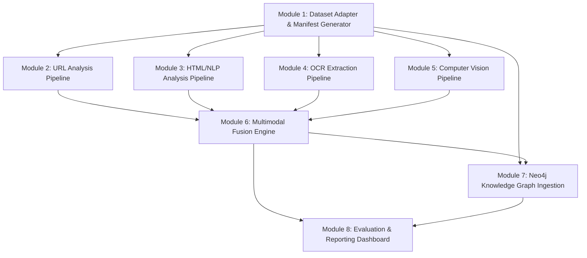

# Multimodal Cybercrime Intelligence Platform: Modular Implementation Plan

**Target Phase:** Phase 8 Implementation Roadmap  
**Guiding Principle:** CPU-friendly baselines first, strict modular isolation, contract-driven test-driven development.

---

## 1. Roadmap Overview & Dependency Matrix

---

## 2. Module Specifications

### Module 1: Dataset Adapter & Streaming Manifest Generator
- **Objective:** Stream `data/phish_sample_30k.zip` without disk extraction to generate `phishpedia_manifest.jsonl` and `phishpedia_manifest.csv`.
- **Inputs:** `data/phish_sample_30k.zip`
- **Outputs:** Manifest files compliant with `schemas/observation.schema.json`.
- **Hardware:** Standard CPU (runs in < 60 seconds).
- **Deliverables:** `scripts/manifest_generator.py`, test suite in `tests/test_adapter.py`.
- **Acceptance Criteria:** 29,496 records indexed; 0 schema validation errors.

### Module 2: URL Analysis Pipeline
- **Objective:** Compute lexical, statistical, and domain authority indicators from raw URLs.
- **Inputs:** `Observation.url` from manifest.
- **Outputs:** `ModelOutputEnvelope` with `modality: "url"`.
- **Hardware:** CPU baseline (LightGBM/XGBoost).
- **Deliverables:** `modules/url_analyzer/`, unit tests.
- **Acceptance Criteria:** > 85% accuracy on phishing URL detection benchmark.

### Module 3: HTML/NLP Analysis Pipeline
- **Objective:** Parse DOM structure, form actions, and text semantics. Gracefully handle the 448 observations missing HTML.
- **Inputs:** `artifacts.html` stream.
- **Outputs:** `ModelOutputEnvelope` with `modality: "html_nlp"`.
- **Hardware:** CPU baseline (BeautifulSoup + scikit-learn TF-IDF).
- **Deliverables:** `modules/html_analyzer/`.
- **Acceptance Criteria:** Return `status: "skipped"` with code `W_HTML_MISSING` on missing files without throwing exceptions.

### Module 4: OCR Extraction Pipeline
- **Objective:** Perform robust optical character recognition on `shot.png`.
- **Inputs:** `artifacts.screenshot` (`shot.png`).
- **Outputs:** `ModelOutputEnvelope` with `modality: "ocr"`.
- **Hardware:** CPU baseline (Tesseract 5 or PaddleOCR CPU mode; optional CUDA acceleration).
- **Deliverables:** `modules/ocr_extractor/`.
- **Acceptance Criteria:** Extract text and credential keywords with confidence scores for 100 test screenshots.

### Module 5: Computer Vision Pipeline
- **Objective:** Detect visual brand identity using precomputed `yolo_coords.txt` or lightweight logo embedding comparison against reference brand gallery.
- **Inputs:** `artifacts.screenshot` + `artifacts.auxiliary.yolo_coords_path`.
- **Outputs:** `ModelOutputEnvelope` with `modality: "computer_vision"`.
- **Hardware:** CPU baseline (MobileNetV3 / EfficientNet-B0 ONNX runtime; optional GPU).
- **Deliverables:** `modules/cv_detector/`, reference brand gallery in `data/reference_brands/`.
- **Acceptance Criteria:** Detect logo candidate crops and match against target brand gallery.

### Module 6: Multimodal Fusion Engine
- **Objective:** Fuse upstream predictions from URL, HTML, OCR, and CV modules; reweight for missing modalities; check brand-domain identity conflicts.
- **Inputs:** Multiple `ModelOutputEnvelope` records sharing an `observation_id`.
- **Outputs:** Unified `ModelOutputEnvelope` with `modality: "multimodal_fusion"`.
- **Hardware:** CPU baseline (rule-based heuristic + calibrated logistic fusion).
- **Deliverables:** `modules/fusion_engine/`, configuration `configs/fusion_weights.yaml`.
- **Acceptance Criteria:** Dynamic weight re-normalization when modalities are skipped; clear supporting evidence explanation list.

### Module 7: Neo4j Knowledge Graph Ingestion
- **Objective:** Map observations, captured artifacts, predictions, and campaign candidates into Neo4j graph nodes and edges.
- **Inputs:** Canonical observations and fusion model envelopes.
- **Outputs:** Populated Neo4j database instances matching `docs/architecture/NEO4J_DATA_MODEL.md`.
- **Hardware:** Neo4j Community / Desktop instance (local or Docker container).
- **Deliverables:** `modules/graph_ingestion/`, Cypher batch migration scripts.
- **Acceptance Criteria:** Idempotent ingestion (repeated runs do not create duplicate nodes); constraint verification passes.

### Module 8: Evaluation & Reporting Dashboard
- **Objective:** Multi-metric benchmarking (Precision, Recall, ROC-AUC, Latency per modality) and digital forensics summary generator.
- **Inputs:** Ingested ground truth and predictions.
- **Outputs:** Evaluation reports and web dashboard.
- **Deliverables:** `modules/evaluator/`, CLI report generator.
