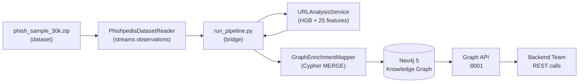

# Knowledge Graph — Integration Guide

**Module:** `modules/graph_enrichment_mapper/`  
**API Port:** 8001 (default)  
**Graph DB:** Neo4j 5 (Bolt `bolt://localhost:7687`)

---

## Quick Start

### 1. Start Neo4j

```powershell
docker compose up -d
# Browser UI → http://localhost:7474  (neo4j / cyraxi_dev)
```

### 2. Install the driver

```powershell
pip install neo4j
```

### 3. Run the pipeline bridge (populates the graph)

```powershell
# Dry-run first — no DB writes, just tests the analysis pipeline
python run_pipeline.py --limit 10 --dry-run

# Real run — streams 500 observations → URL analysis → Neo4j
python run_pipeline.py --limit 500 --batch-size 50
```

### 4. Start the Graph API

```powershell
uvicorn modules.graph_enrichment_mapper.api.server:app --port 8001 --reload
# Swagger UI → http://localhost:8001/docs
```

---

## Architecture



---

## Graph Schema

| Node | Key Property | Written from |
|---|---|---|
| `Observation` | `observation_id` | info.txt + dataset adapter |
| `URL` | `url_hash` (sha256) | info.txt `url` field |
| `Domain` | `name` (FQDN) | parsed from host |
| `IPAddress` | `ip` | info.txt `ip` field |
| `AutonomousSystem` | `asn` | info.txt `asn` field |
| `Brand` | `brand_id` (slug) | info.txt `brand` field |
| `ModelRun` | `run_id` | pipeline run_id + modality |
| `Prediction` | `prediction_id` | model output envelope |
| `CampaignCandidate` | `campaign_id` | info.txt `family_id` |

---

## API Endpoints

### Ingestion

```
POST /api/v1/graph/ingest
Content-Type: application/json

{
  "observation_meta": {
    "observation_id": "obs_...",
    "url": "http://fake-paypal.xyz/login",
    "brand": "PayPal",
    "ip": "1.2.3.4",
    "asn": "AS999",
    "asn_name": "BadHost LLC",
    "host": "fake-paypal.xyz",
    "tld": "xyz",
    "country_code": "RU",
    "country_name": "Russia",
    "family_id": "abc123",
    "sector": "Finance"
  },
  "model_outputs": [ <URLModelOutputEnvelope dict> ]
}
```

### Queries

```
GET /api/v1/graph/brand/PayPal?limit=50
GET /api/v1/graph/ip/1.2.3.4?limit=50
GET /api/v1/graph/campaign/abc123?limit=100
```

---

## Useful Cypher Queries (Neo4j Browser)

```cypher
-- All nodes overview
MATCH (n) RETURN labels(n), count(n) ORDER BY count(n) DESC

-- Top 10 most targeted brands
MATCH (o:Observation)-[:TARGETS_BRAND]->(b:Brand)
RETURN b.name AS brand, count(o) AS observations
ORDER BY observations DESC LIMIT 10

-- Top 10 hosting ASNs by phishing volume
MATCH (o:Observation)-[:CAPTURED_URL]->(u:URL)-[:HOSTED_ON]->(d:Domain)
      -[:RESOLVED_TO]->(i:IPAddress)-[:ANNOUNCED_BY]->(a:AutonomousSystem)
RETURN a.name AS asn, a.asn AS asn_code, count(DISTINCT d.name) AS domains_hosted
ORDER BY domains_hosted DESC LIMIT 10

-- Campaign clusters with >5 observations
MATCH (o:Observation)-[:SUSPECTED_CAMPAIGN_MEMBER]->(c:CampaignCandidate)
WITH c, count(o) AS obs_count
WHERE obs_count > 5
RETURN c.family_id, obs_count ORDER BY obs_count DESC

-- High-confidence phishing predictions
MATCH (p:Prediction)-[:APPLIES_TO]->(o:Observation)-[:CAPTURED_URL]->(u:URL)
WHERE p.confidence >= 0.90 AND p.modality = 'url'
RETURN u.raw_url AS url, p.confidence AS score, p.top_risk_factors AS risk_factors
ORDER BY p.confidence DESC LIMIT 20

-- Full graph path for one observation
MATCH path = (o:Observation {observation_id: '<obs_id>'})-[*1..3]-(n)
RETURN path
```

---

## run_pipeline.py Flags

| Flag | Default | Description |
|---|---|---|
| `--limit` | 100 | Number of observations to process |
| `--offset` | 0 | Skip first N records |
| `--batch-size` | 50 | Progress log frequency |
| `--dry-run` | false | Skip Neo4j writes |
| `--archive` | `data/phish_sample_30k.zip` | Dataset path |
| `--model` | `url_hgb_model.joblib` | ML model path |
| `--quiet` | false | Suppress progress output |

---

## What's Next After Bulk Ingestion

1. **Explore the graph** in Neo4j Browser (`http://localhost:7474`)
2. **Add OCR + HTML analysis results** to the graph (same `model_outputs` list)
3. **Graph-assisted prediction** — when a new URL arrives, look up its IP/ASN in the graph to get historical phishing context as an additional feature
4. **Campaign clustering** — use graph community detection (APOC algorithms) to find clusters beyond `family_id`
