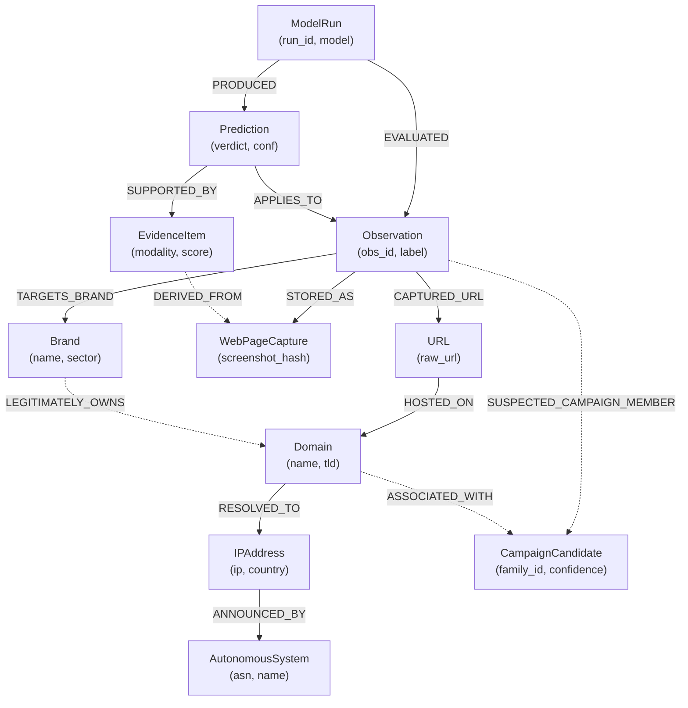

# Neo4j Graph Data Model for Multimodal Cybercrime Intelligence

**Document Version:** 1.0.0  
**Target Engine:** Neo4j 5.x Enterprise / Community  
**Integration Module:** `graph_enrichment_mapper`

---

## 1. Overview & Architecture

The graph database represents the relational topology connecting digital infrastructure, captured evidence artifacts, analytical model runs, targeted brands, and threat campaign clusters.

### Key Tenet on Campaign Association
> [!IMPORTANT]
> Visual similarity or a shared target brand is **not** definitive proof of attacker attribution. Attackers often copy each other's kits. In this data model, relationships between disparate domains or captures and threat campaigns are represented explicitly as **Candidate** relationships (`SUSPECTED_CAMPAIGN_MEMBER`) tagged with algorithm provenance, similarity metrics, and confidence scores.

---

## 2. Graph Schema & Node Entities

| Node Label | Key Identifier (`id`) | Primary Properties | Conceptual Meaning |
|---|---|---|---|
| `Observation` | `observation_id` (UUID/hash) | `source_record_id`, `dataset_id`, `created_at`, `label` | A single crawl/capture snapshot |
| `URL` | `url_hash` (sha256(raw_url)) | `raw_url`, `scheme`, `path`, `query` | Normalized Web URL |
| `Domain` | `name` (FQDN/SLD) | `tld`, `subdomain_count`, `registered_domain` | Internet domain authority |
| `IPAddress` | `ip` (IPv4/IPv6 string) | `country_code`, `country_name` | Host IP address at capture |
| `AutonomousSystem` | `asn` (e.g. `AS51468`) | `name` (e.g. `One.com A/S`) | Routing authority / ISP |
| `WebPageCapture` | `capture_id` | `screenshot_hash`, `html_hash`, `capture_time` | Physical artifact bundle |
| `Brand` | `brand_id` (slug) | `name`, `sector`, `official_domain` | Targeted commercial identity |
| `EvidenceItem` | `evidence_id` | `modality`, `metric_name`, `score`, `description` | Atomic piece of evidence |
| `ModelRun` | `run_id` | `model_name`, `version`, `executed_at`, `hardware` | Execution event of an analyzer |
| `Prediction` | `prediction_id` | `verdict`, `confidence`, `status` | Model inference verdict |
| `CampaignCandidate` | `campaign_id` | `family_id`, `first_seen`, `confidence` | Inferred phishing infrastructure cluster |

---

## 3. Graph Relationships

| Source Node | Relationship | Target Node | Key Properties |
|---|---|---|---|
| `Observation` | `CAPTURED_URL` | `URL` | `timestamp` |
| `Observation` | `STORED_AS` | `WebPageCapture` | `has_html`, `has_ocr` |
| `URL` | `HOSTED_ON` | `Domain` | - |
| `Domain` | `RESOLVED_TO` | `IPAddress` | `resolved_at` |
| `IPAddress` | `ANNOUNCED_BY` | `AutonomousSystem` | - |
| `Observation` | `TARGETS_BRAND` | `Brand` | `confidence`, `is_ground_truth` |
| `ModelRun` | `EVALUATED` | `Observation` | `latency_ms` |
| `ModelRun` | `PRODUCED` | `Prediction` | `created_at` |
| `Prediction` | `APPLIES_TO` | `Observation` | - |
| `Prediction` | `SUPPORTED_BY` | `EvidenceItem` | `weight_contribution` |
| `Observation` | `SUSPECTED_CAMPAIGN_MEMBER` | `CampaignCandidate` | `family_id`, `similarity_score`, `method` |
| `Brand` | `LEGITIMATELY_OWNS` | `Domain` | `verified`: true |

---

## 4. Mermaid Graph Diagram



---

## 5. Uniqueness Constraints & Performance Indexes (Cypher)

```cypher
// Uniqueness Constraints
CREATE CONSTRAINT c_obs_id IF NOT EXISTS FOR (o:Observation) REQUIRE o.observation_id IS UNIQUE;
CREATE CONSTRAINT c_url_hash IF NOT EXISTS FOR (u:URL) REQUIRE u.url_hash IS UNIQUE;
CREATE CONSTRAINT c_domain_name IF NOT EXISTS FOR (d:Domain) REQUIRE d.name IS UNIQUE;
CREATE CONSTRAINT c_ip_addr IF NOT EXISTS FOR (i:IPAddress) REQUIRE i.ip IS UNIQUE;
CREATE CONSTRAINT c_asn IF NOT EXISTS FOR (a:AutonomousSystem) REQUIRE a.asn IS UNIQUE;
CREATE CONSTRAINT c_brand_id IF NOT EXISTS FOR (b:Brand) REQUIRE b.brand_id IS UNIQUE;
CREATE CONSTRAINT c_run_id IF NOT EXISTS FOR (r:ModelRun) REQUIRE r.run_id IS UNIQUE;
CREATE CONSTRAINT c_pred_id IF NOT EXISTS FOR (p:Prediction) REQUIRE p.prediction_id IS UNIQUE;
CREATE CONSTRAINT c_campaign_id IF NOT EXISTS FOR (c:CampaignCandidate) REQUIRE c.campaign_id IS UNIQUE;

// Indexes for Search & Traversal
CREATE INDEX idx_obs_captured_at IF NOT EXISTS FOR (o:Observation) ON (o.captured_at);
CREATE INDEX idx_brand_name IF NOT EXISTS FOR (b:Brand) ON (b.name);
CREATE INDEX idx_campaign_family IF NOT EXISTS FOR (c:CampaignCandidate) ON (c.family_id);
```

---

## 6. Sample Cypher Ingestion Query (Example Illustration)

```cypher
// 1. Ingest Canonical Observation and Network Graph
MERGE (o:Observation {observation_id: 'obs_6f80a42371d377b212f45c4aa305609c'})
ON CREATE SET 
    o.source_record_id = '1&1 Ionos+2019-07-28-22`34`40',
    o.dataset_id = 'phishpedia_primary',
    o.captured_at = datetime('2019-07-02T21:14:13Z'),
    o.ground_truth_label = 'phishing';

MERGE (u:URL {url_hash: '3a18e001851e3c83756b19a164b38d388fbfef1120f5c8846c4f74d081f9b31d'})
ON CREATE SET 
    u.raw = 'http://serv-acamai.com/1und1/de/index.php',
    u.host = 'serv-acamai.com';

MERGE (d:Domain {name: 'serv-acamai.com'})
ON CREATE SET 
    d.tld = 'com';

MERGE (i:IPAddress {ip: '46.30.213.230'})
ON CREATE SET 
    i.country_code = 'DK',
    i.country_name = 'Denmark';

MERGE (a:AutonomousSystem {asn: 'AS51468'})
ON CREATE SET 
    a.name = 'One.com A/S';

MERGE (b:Brand {brand_id: '1_1_ionos'})
ON CREATE SET 
    b.name = '1&1 Ionos',
    b.sector = 'Online Services';

MERGE (c:CampaignCandidate {campaign_id: 'camp_a53630ccd2f8d0771873a43b98ae0c0d'})
ON CREATE SET
    c.family_id = 'a53630ccd2f8d0771873a43b98ae0c0d',
    c.first_seen = datetime('2019-07-02T21:14:13Z');

// Connect Edges
MERGE (o)-[:CAPTURED_URL]->(u);
MERGE (u)-[:HOSTED_ON]->(d);
MERGE (d)-[:RESOLVED_TO]->(i);
MERGE (i)-[:ANNOUNCED_BY]->(a);
MERGE (o)-[:TARGETS_BRAND {is_ground_truth: true}]->(b);
MERGE (o)-[:SUSPECTED_CAMPAIGN_MEMBER {method: 'source_family_id'}]->(c);
```
