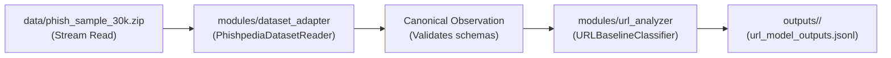

# CYRAXI Vertical Slice: Dataset-to-Model Pipeline Guide

**Status:** Verified Operational Baseline  
**Pipeline Entry Point:** [`run_slice.py`](../../run_slice.py)  
**Schema Compliance:** [`schemas/observation.schema.json`](../../schemas/observation.schema.json) & [`schemas/model-output.schema.json`](../../schemas/model-output.schema.json)  

---

## 1. Overview

This vertical slice connects the primary Phishpedia data archive to the first analytical module without extracting the 19 GB zip file to disk.



---

## 2. Command to Run the Pipeline

Run the pipeline from the workspace root:

```powershell
python run_slice.py --limit 30 --output-dir outputs/slice_run_01
```

### Supported CLI Arguments
- `--archive`: Path to the Phishpedia zip archive (default: `data/phish_sample_30k.zip`).
- `--limit`: Number of records to stream-process (default: `30`, recommended `20–50`).
- `--offset`: Record index offset to begin streaming from (default: `0`).
- `--output-dir`: Target folder for output files (default: `outputs/slice_run_01`).
- `--run-id`: Unique execution identifier (e.g. `run_20261011_eval_v1`).

---

## 3. Output Structure

Execution outputs are isolated in the specified `--output-dir` and never touch the raw data directory:

1. `processed_observations.jsonl`: Line-delimited canonical observation records matching `schemas/observation.schema.json`.
2. `url_model_outputs.jsonl`: Line-delimited model envelopes matching `schemas/model-output.schema.json`.
3. `run_summary.json`: High-level run metrics (counts, latencies, warnings).

---

## 4. Extracted URL Features

The URL analysis module extracts 16 lexical and structural features:
- `url_length`, `host_length`, `path_length`, `query_length`
- `path_depth`: Number of slash-delimited segments
- `num_digits`: Count of numeric characters
- `num_special_chars`: Count of `-_=?&%@!~+`
- `num_hyphens`: Subdomain / path hyphen count
- `num_subdomains`: Multi-level subdomain count
- `has_ip_in_host`: IPv4 address host check
- `has_https`: SSL/TLS scheme check
- `has_at_symbol`: HTTP Basic auth deception check (`@`)
- `has_double_slash_in_path`: Open-redirect cue (`//`)
- `entropy_full_url`: Shannon character entropy of URL
- `entropy_host`: Shannon character entropy of hostname
- `suspicious_tld`: Known high-abuse top-level domains

---

## 5. Running the Unit Tests

Execute the unit test suite:

```powershell
python -m unittest tests/test_slice.py
```

All 10 tests verify:
- Deterministic observation ID generation
- URL component parsing & empty URL resilience
- Handling missing artifacts (missing HTML / OCR)
- Shannon entropy computation
- Feature extraction accuracy
- High-risk score classification
- Record validation warnings
